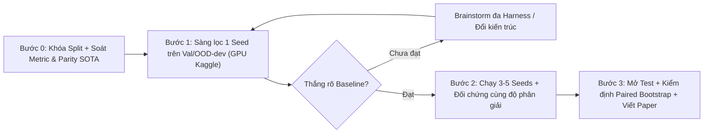

# Kinh Nghiệm Nghiên Cứu & Điều Phối Thực Nghiệm (Playbook Mang Sang Dự Án Mới)

> **Mục đích tài liệu:** Tổng hợp các nguyên tắc, nhắc nhớ của người dùng trong quá trình chat và các bài học thực chiến rút ra từ dự án IRSTD (119 thí nghiệm, 167 lượt chạy) cùng chuỗi dự án trước đó. Tài liệu này được viết dưới dạng **Playbook có thể tái sử dụng trực tiếp** để đưa vào đầu các dự án nghiên cứu mới (hướng tới bài báo Q1 / IEEE Access với ngân sách GPU giới hạn).

---

## 1. Chiến Lược Chọn Đề Tài & Định Hướng Đóng Góp (Paper Q1 với GPU Giới Hạn)

1. **Chọn bài toán vừa sức phần cứng (T4 16GB / L4 24GB):**
   - Ưu tiên bài toán có kích thước dữ liệu gọn ($< 1\text{--}2\text{ GB}$), mô hình chuẩn vài triệu tham số, một lượt huấn luyện tốn khoảng $1\text{--}3\text{ giờ}$ trên T4 để có thể lặp nhanh và chạy đủ nhiều seed.
   - Tránh các hướng mà SOTA hiện tại phụ thuộc vào việc fine-tune foundation model khổng lồ (như DINOv3-7B trên card 48–80GB VRAM) nếu chỉ có T4/L4.

2. **Không đi theo lối mòn "lắp ghép module / thêm loss phụ" khi đã bão hòa:**
   - Cảnh giác với việc chỉ gắn thêm một nhánh chuẩn hóa cục bộ, khối attention nhỏ, hay cộng thêm hàm mất mát phụ (*auxiliary loss*) lên một backbone cũ. Reviewer các tạp chí Q1 rất dễ bác bỏ nếu đóng góp bị xem là "ghép module".
   - Khi hướng cải tiến trên mô hình cơ sở bị chững lại (chỉ nhích $\sim 0.5\text{--}1\%$ nằm trong nhiễu seed), **phải dừng ngay lối mòn cũ, tách một nhánh mới để thay đổi hẳn paradigm** (đổi họ kiến trúc, đổi biểu diễn đầu ra từ mặt nạ dày sang đối tượng thưa, hoặc đổi cơ chế suy luận).

3. **Kiểm chứng tiền lệ (Novelty Check) từ toàn văn bài báo năm mới nhất trước khi code:**
   - Luôn yêu cầu tìm và đọc kỹ phần phương pháp của các bài SOTA mới nhất (2025–2026), **không chỉ đọc abstract**.
   - Nếu từng thành phần (ví dụ: kiểm định giả thuyết thống kê ở đầu dò, tái dựng nền, chèn mục tiêu giả lập) đã có tiền lệ trực tiếp, chỉ tiếp tục khi cơ chế kết hợp trả lời được một câu hỏi khoa học mới và thắng được tất cả các nhánh đối chứng thành phần (*component controls*).

---

## 2. Thiết Kế Benchmark Cố Định & Quy Trình Làm "Từ Từ" (Iterative Workflow)



1. **Cố định Benchmark lõi ngay từ đầu:**
   - Chốt cố định **2 bộ dữ liệu** xuyên suốt giai đoạn phát triển: 1 tập chính khó (chưa bão hòa) và 1 tập phụ có độ lệch miền lớn để đo khả năng tổng quát hóa chéo miền (OOD) hai chiều.
   - Nếu có một bộ dữ liệu mà baseline đã quá cao (bão hòa $95\text{--}97\%$), chỉ dùng nó để kiểm tra "không bị tụt", và **bổ sung thêm điều kiện test trên bộ dữ liệu khó / chéo miền mà baseline đạt điểm thấp** để phân định thắng thua rõ ràng.
   - Khóa cứng phân hoạch `fit / val / calib / test` bằng seed cố định kèm mã băm SHA256.

2. **Kỷ luật bảo vệ tập `test` (Tránh quá khớp ngầm & Winner's Curse):**
   - Tách riêng `val` (chọn checkpoint & sàng lọc kiến trúc), `calib` (chỉ để khóa ngưỡng quyết định $\tau$), và `OOD-dev` (lấy từ phần `val + calib` của tập kia để theo dõi chuyển miền mà không chạm `test`).
   - Trong suốt quá trình sửa code, chỉnh loss, thử kiến trúc: **chỉ chấm trên `val` và `OOD-dev`**. Chỉ mở tập `test` ở các mốc lớn khi mô hình đã vượt qua vòng sàng lọc.

3. **Cải thiện mô hình cho thắng áp đảo ở 1 seed trước khi chạy nhiều seed và thêm dữ liệu:**
   - **Quy tắc tiết kiệm thời gian & GPU:** Tuyệt đối không chạy 3–5 seeds hay mở rộng thêm bộ dữ liệu khi mô hình đề xuất chưa thắng rõ rệt baseline ở vòng sàng lọc 1 seed.
   - Sửa triệt để các lỗi đang mắc phải (code, hàm loss, tiền xử lý) trước, sau đó mới chạy đa seed.
   - Nếu sau một đợt thử nghiệm kiến trúc mới (đã giới hạn thời gian/số vòng) mà vẫn không vượt thêm được, dứt khoát dùng kiến trúc tốt nhất đã được xác nhận để chạy đủ seed và chuyển sang viết paper, tránh sa lầy vô hạn.

4. **Đặt mục tiêu chỉ số hợp lý về mặt toán học:**
   - Không đặt mục tiêu kiểu *"tăng tương đối $+15\%$ trên mọi chỉ số"* cho những thước đo đã tiệm cận trần $100\%$ (ví dụ: khi tỷ lệ phát hiện $P_d$ của baseline đã ở mức $92\text{--}93\%$, tăng $+15\%$ tương đối sẽ vượt $100\%$).
   - Với các chỉ số tiệm cận $100\%$, phải quy đổi mục tiêu thành **giảm tỷ lệ lỗi / bỏ sót** ($1 - P_d$ giảm $\ge 15\text{--}20\%$) hoặc **giảm tỷ lệ báo động giả** ($F_a$ giảm $\ge 30\text{--}50\%$), đồng thời yêu cầu khoảng tin cậy 95% của mức cải thiện không chứa $0$.

---

## 3. Các "Bẫy" Thực Nghiệm Xương Máu Cần Kiểm Tra Đầu Tiên

1. **Sửa lỗi dữ liệu & tiền xử lý trước khi quy công cho kiến trúc:**
   - Trong dự án IRSTD, một lỗi nhỏ ở pipeline dữ liệu (ảnh được pad `reflect` nhưng mask lại pad `0`, làm nhân bản mục tiêu không nhãn ở biên; hoặc `random crop` làm rơi mất mục tiêu nhỏ trong $16\%$ mẫu) đã làm tụt điểm nặng nề. Riêng việc sửa 1 dòng code padding (`PadMaskFix`) đã giúp tăng $+2.5\text{pp IoU}$ và $+6\text{pp } P_d$ — lớn hơn mọi module kiến trúc phức tạp trước đó.
   - **Bài học:** Khi thấy một nhánh mới tăng điểm bất ngờ, phải kiểm tra xem nhánh đó có đi kèm sửa đổi tiền xử lý/augmentation nào không, và **bắt buộc chạy lại baseline gốc với đúng bản sửa dữ liệu đó (*Matched Control*)** trước khi tuyên bố kiến trúc mới tốt hơn.

2. **Đòn bẩy độ phân giải gốc (Native Resolution) và Bẫy so sánh lệch độ phân giải:**
   - Thu nhỏ ảnh gốc (ví dụ từ $512\times 512$ xuống $256\times 256$) làm biến mất các mục tiêu nhỏ $1\text{--}4\text{ px}$. Chỉ riêng việc giữ nguyên độ phân giải gốc $512\text{ px}$ đã tăng $+4\text{--}6\text{ điểm IoU}$ và $+10\text{ điểm IoU}$ cho mục tiêu nhỏ.
   - **Bẫy nghiêm trọng:** Không bao giờ so sánh mô hình của mình chạy ở $512\text{ px}$ với baseline chạy ở $256\text{ px}$ rồi kết luận kiến trúc của mình vượt SOTA. Khi cho các mô hình SOTA (DGNet, MSHNet) cùng nhìn đầu vào $512\text{ px}$, khoảng cách IoU gần như biến mất. **Mọi bảng so sánh phải khớp hoàn toàn về độ phân giải đầu vào và lưới chấm điểm (Resolution-Matched Control).**

3. **Kiểm tra độ trung thực (Parity Check) của các mô hình SOTA được port vào repo:**
   - Không chép số từ bài báo gốc vào bảng so sánh nếu khác cách chia tập (`fit/val/test`) hoặc khác độ phân giải.
   - Khi đưa code của SOTA (như DGNet, SCTransNet) vào pipeline chung:
     - Phải đối chiếu với repo chính thức và kiểm tra parity bằng checkpoint gốc trước.
     - Không ép mọi SOTA dùng chung một bộ siêu tham số tối ưu (learning rate, batch size, hàm loss) của mô hình mình nếu nó làm SOTA bị sập (ví dụ: DGNet bị sập về toàn nền dưới công thức chung; bản port SCTransNet bị lỗi dự đoán toàn bộ ảnh là mục tiêu ở một số seed). Nếu bản port SOTA bị lỗi chưa sửa được, phải loại khỏi mốc so sánh chính thức.

4. **Bẫy phương sai hạt giống (Seed Variance) & Bẫy gộp seed trong Bootstrap:**
   - Trên các tập test nhỏ ($80\text{--}200$ ảnh), chênh lệch giữa các seed của cùng một mô hình có thể lên tới $3\text{--}8\text{ điểm IoU}$ (ví dụ: 5 seed của DGNet trải từ $56.2\%$ đến $64.7\%$). Một lượt chạy 1 seed tăng $+2\text{--}4\text{ điểm IoU}$ rất dễ chỉ là một seed may mắn.
   - Mọi kết luận chính thức phải dựa trên **$\ge 3\text{--}5$ seeds độc lập (cùng danh sách seed giữa các mô hình)** và dùng **Paired Two-Stage Bootstrap (lấy mẫu lại theo cả cấp độ `seed` lẫn cấp độ `image`)**, tuyệt đối không cộng gộp tất cả seed lại như các ảnh độc lập vì sẽ làm hẹp giả tạo khoảng tin cậy.

5. **Bẫy hiệu chuẩn ngưỡng (Threshold Calibration) trong miền Sigmoid:**
   - Khi chọn ngưỡng $\tau$ trên tập `calib` nhỏ ($66\text{--}80$ ảnh) theo ngân sách báo động giả, thực hiện trong miền xác suất `sigmoid` dễ gặp hiện tượng bão hòa ($\tau = 1.0$, biến mô hình thành bộ dò rỗng $P_d = 0$ nhưng vẫn được tính là thỏa mãn $F_a \le \alpha$). Phải hiệu chuẩn trong **miền logit** kèm điều kiện ràng buộc $P_d > 0$.

---

## 4. Kinh Nghiệm Phối Hợp Đa Tác Nhân (Cross-Harness Review & Ideation)

1. **Dùng nhiều Harness khác hãng để phản biện chéo (Cross-Harness Review):**
   - Không để một AI / một mô hình vừa tự thiết kế, tự chạy, vừa tự khen kết quả của mình.
   - Ở mỗi mốc quan trọng (sau khi thiết kế kế hoạch, sau một vòng chạy qua đêm, hoặc trước khi viết paper), gọi đồng thời **2–3 harness khác hãng** (ví dụ: Claude Opus / Sonnet trên Claude Code, GPT/Codex, Gemini trên Antigravity) làm **Independent Reviewer (chế độ chỉ đọc — Read-Only, cấm chạy GPU)**.
   - Yêu cầu Reviewer tự đọc file log gốc (`metrics_summary.json`, code trên git branch) thay vì chỉ đọc báo cáo tóm tắt. Trong dự án này, chính cơ chế Cross-Harness Review đã phát hiện ra:
     - Số liệu chép nhầm từ log vào bảng báo cáo cũ;
     - Lỗi `REFLECT` padding trên mặt nạ;
     - Việc tăng điểm ở $512\text{ px}$ đến từ độ phân giải chứ không phải kiến trúc.

2. **Brainstorm song song từ nhiều Harness khi cần ý tưởng đột phá:**
   - Khi mô hình bị chững lại, giao cùng một bản tóm tắt bằng chứng (*Evidence Brief* — nêu rõ những gì đã thử và thất bại) cho 3 harness độc lập để mỗi bên đề xuất 3–4 hướng mới kèm **thử nghiệm bác bỏ rẻ (cheap kill-test)**.
   - Chỉ chọn chạy thực nghiệm những ý tưởng có cơ chế rõ ràng hoặc được nhiều nguồn hội tụ đánh giá cao.

3. **Giữ báo cáo và bảng biểu trực quan theo thời gian thực:**
   - Luôn duy trì một bảng tổng hợp chuẩn và biểu đồ trực quan (HTML tương tác + PDF/SVG chuẩn xuất bản) thể hiện rõ chênh lệch giữa mô hình tốt nhất hiện tại với các baseline/SOTA (kèm thanh sai số qua các seed) để người dùng nắm bắt ngay trạng thái dự án mà không cần đọc log thô.
   - Khi chuẩn bị viết paper: kiểm tra kỹ **template LaTeX của đúng tạp chí mục tiêu** (ví dụ: IEEE Access khác hoàn toàn CMC) và kiểm tra lỗi biên dịch tài liệu tham khảo (`references` / `.bib`) ngay từ đầu.

---

## 5. Kinh Nghiệm Vận Hành Hạ Tầng & Tối Ưu Chi Phí GPU

1. **Tận dụng tối đa dàn tài khoản Kaggle miễn phí cho sàng lọc và chạy đa seed:**
   - Khi có nhiều tài khoản Kaggle dư, tận dụng chạy song song (mỗi tài khoản Kaggle chạy được tối đa **2 phiên GPU T4 đồng thời**) cho toàn bộ các lượt sàng lọc 1 seed, ablation và các lượt chạy đa seed vừa bộ nhớ T4 (15–16 GB VRAM).
   - **Không dùng DDP trên $2\times\text{T4}$** cho mô hình nhỏ vì dễ bị treo; thay vào đó hãy chạy **2 mô hình hoặc 2 seed độc lập song song**, mỗi card T4 một lượt chạy.
   - Tránh đẩy/tạo dataset Kaggle liên tiếp quá nhanh trên cùng một tài khoản để không bị lỗi giới hạn API (`HTTP 403 / 499`).

2. **Phân bổ GPU trả phí (Colab / Modal / GCP) đúng chỗ:**
   - Chỉ dùng GPU trả phí (L4 24GB, A100 40GB) khi:
     1. Mô hình đã vượt qua vòng sàng lọc trên Kaggle T4 và cần chạy chốt đa seed nhanh; hoặc
     2. Cấu hình bắt buộc vượt quá 15 GB VRAM của T4 (như train baseline DGNet ở độ phân giải $512\text{ px}$ với batch size 16).
   - **Bắt buộc chạy Smoke Test (CPU hoặc 1–2 epoch ngắn)** trước khi gửi job dài lên GPU từ xa để kiểm tra đỉnh VRAM và tốc độ mỗi epoch (tránh tình trạng tràn bộ nhớ ngầm làm thời gian mỗi epoch tăng gấp 10 lần rồi treo).

3. **An toàn vận hành máy Local & Chế độ chạy tự động qua đêm (Sleep Mode):**
   - **Không chạy huấn luyện hoặc suy luận nặng trực tiếp trên máy local** (máy local chỉ có $\sim 14\text{ GB RAM}$, rất dễ tràn bộ nhớ gây treo phiên làm việc); máy local chỉ dùng để sửa code, phân tích JSON/CSV nhẹ và điều phối job.
   - **Lưu ý khi máy local tạm dừng (Suspend) hoặc quá thời gian chờ:**
     - Nếu máy local ngủ hoặc tiến trình theo dõi bị ngắt (`SIGTERM` sau $>5\text{ giờ}$), các kernel trên **Kaggle vẫn tiếp tục chạy độc lập đến khi hoàn tất** — khi tỉnh dậy, hãy kiểm tra trạng thái kernel và tải lại kết quả (`output`) về nhập vào hệ thống thay vì bấm chạy lại gây lãng phí.
     - Ngược lại, với **Colab trả phí**, nếu máy local ngủ làm mất kết nối hoặc runtime bị thu hồi ở những epoch cuối (ví dụ epoch 119/120), lượt chạy sẽ mất kết quả mà vẫn tốn credit — nên ưu tiên giữ máy mở hoặc dùng backend bất đồng bộ như Kaggle cho các lượt chạy qua đêm.

---

## 6. Checklist Nhanh Khi Bắt Đầu Dự Án Mới (Copy-Paste Cho Agent)

Khi khởi động dự án mới, có thể gửi kèm khối chỉ thị sau cho Agent:

```markdown
### Quy tắc làm việc bắt buộc của dự án:
1. **Không đi lối mòn ghép module:** Ưu tiên thay đổi có cơ chế rõ ràng và kiểm tra kỹ tiền lệ 2025–2026 từ toàn văn bài báo trước khi code.
2. **Khóa chặt giao thức đánh giá:** Cố định split `fit / val / calib / test`. Mọi vòng sàng lọc 1 seed chỉ chấm trên `val` và `OOD-dev`, tuyệt đối không chọn mô hình trên `test`.
3. **Kiểm tra dữ liệu & độ phân giải trước:** Mọi thay đổi về tiền xử lý, padding, crop hay độ phân giải đầu vào phải có nhánh đối chứng (Matched Control) trên baseline và SOTA ở cùng độ phân giải trước khi quy công cho kiến trúc.
4. **Thắng rõ ở 1 seed rồi mới nhân rộng:** Chỉ chạy 3–5 seeds và mở rộng dataset khi mô hình đã thắng thuyết phục baseline trên `val`. Khi báo cáo kết quả cuối, bắt buộc dùng cùng danh sách seed và kiểm định Paired Two-Stage Bootstrap (seed × image).
5. **Phản biện chéo đa Harness:** Ở mỗi mốc quan trọng, gọi thêm Claude Code và Codex/Gemini (chế độ read-only) để kiểm tra độc lập code, log và bảng số liệu.
6. **Tối ưu GPU:** Luôn smoke test trước khi chạy thật. Tận dụng tối đa các tài khoản Kaggle T4 miễn phí (chạy song song từng seed trên từng T4, không dùng DDP 2×T4) trước khi dùng GPU trả phí (Colab/Modal/GCP). Không chạy tác vụ nặng làm tràn RAM máy local.
```
